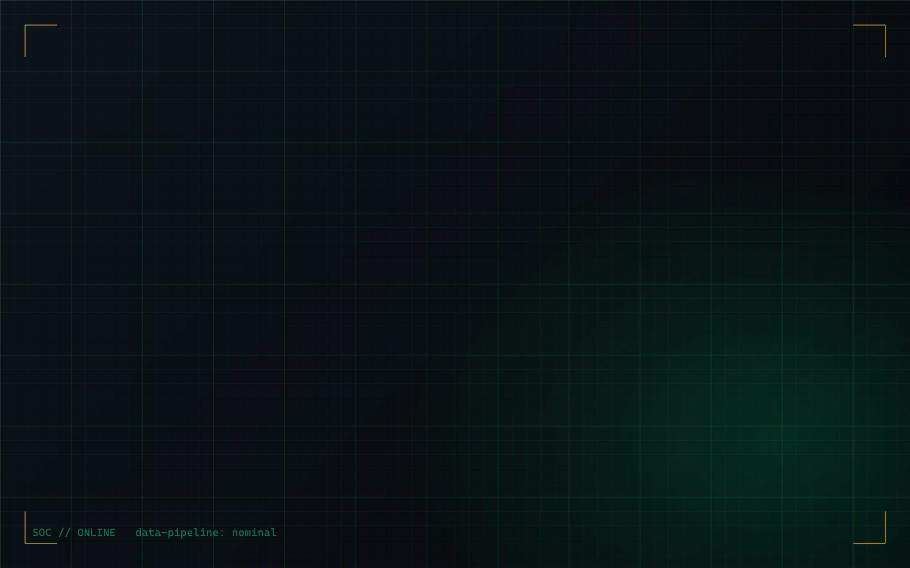

# windows-geek-theme

Setup Windows 11 sombre, façon **SOC analyst + data engineer** : fond `#0b0f14`, accent vert « matrix » `#00ff9c`, ambre pour les alertes, monospace partout, fenêtres semi-transparentes là où Windows le permet.

Un seul orchestrateur (`install.ps1`), des étapes **idempotentes et réversibles**, un journal de tout ce qui change, et un `revert.ps1` qui annule tout.



## Démarrage rapide

```powershell
# 1. Voir le plan sans rien modifier
powershell -ExecutionPolicy Bypass -File .\install.ps1 -DryRun

# 2. Tout appliquer (demande confirmation avant installations, WSL et HKLM)
powershell -ExecutionPolicy Bypass -File .\install.ps1

# Variantes
.\install.ps1 -Steps 1,2,8            # étapes choisies (la 00 s'exécute toujours en premier)
.\install.ps1 -Accent cyan -Taskbar center
.\install.ps1 -Yes                    # sans confirmations (déploiement automatisé)

# Tout annuler
powershell -ExecutionPolicy Bypass -File .\revert.ps1
powershell -ExecutionPolicy Bypass -File .\revert.ps1 -RemovePackages   # + désinstalle les paquets installés par le projet
```

`-ExecutionPolicy Bypass` ne vaut que pour ce processus : la politique d'exécution de la machine n'est pas modifiée.

## Architecture

```
windows-geek-theme/
├── install.ps1              Orchestrateur : paramètres, transcript, boucle sur steps/, résumé
├── revert.ps1               Rejoue le journal à l'envers (registre, blocs de profil, fichiers, WSL)
├── lib/
│   ├── common.ps1           Journal, Set-RegValue (mémorise l'ancienne valeur), blocs gérés, winget, API natives
│   └── wallpaper.ps1        Génération du fond (System.Drawing, aucun téléchargement)
├── steps/                   Une étape = un script autonome
│   ├── 00-restore-point     Point de restauration + export .reg des clés touchées      (abandon si échec)
│   ├── 01-windows-theme     Mode sombre, accent, transparence                          HKCU
│   ├── 02-taskbar           Barre épurée, alignée à gauche, widgets/Chat/Task View off HKCU
│   ├── 03-packages          winget + modules PowerShell                                CONFIRMATION
│   ├── 04-powershell        Profil PowerShell (bloc géré) + thème Oh My Posh           fichiers utilisateur
│   ├── 05-terminal          Palette + profils acryliques (extension « fragment »)      fichiers utilisateur
│   ├── 06-vscode            Thème sombre intégré + police + couleurs                   fichiers utilisateur
│   ├── 07-wsl               Debian + prompt identique                                  CONFIRMATION
│   ├── 08-wallpaper         Fond généré 3840x2160, appliqué                            HKCU
│   ├── 09-lockscreen        Écran de verrouillage/connexion + politique Widgets        HKLM, CONFIRMATION
│   ├── 10-tiling-bar        Tiling GlazeWM + barre Zebar + barre native auto-masquée   CONFIRMATION
│   ├── 11-launcher          Lanceur wofi-like (win+d) : fzf dans un Terminal flottant   fichiers utilisateur
│   └── 12-single-desktop    Un seul bureau virtuel (GlazeWM utilise ses workspaces)     CONFIRMATION
├── config/
│   ├── oh-my-posh/soc-matrix.omp.json    Prompt : user@host, chemin, git, venv Python, code retour, durée, heure
│   ├── powershell/profile.block.ps1      PSReadLine, Terminal-Icons, zoxide, fzf (Ctrl+R), eza, btop
│   ├── windows-terminal/fragment.json    Schéma « SOC Matrix » + 3 profils (opacité 80 %, acrylique)
│   ├── glazewm/config.yaml               Tiling : gaps 12 px, bordure verte, raccourcis ALT, 9 workspaces
│   ├── zebar/                            Barre du haut : zpack.json, bar.html, styles.css, icons.css (Nerd Font locale)
│   ├── launcher/launcher.ps1             Lanceur d'applications / commandes / recherche web (fzf)
│   ├── vscode/settings.snippet.json      Référence si la fusion automatique est impossible
│   └── wsl/setup-root.sh, setup-user.sh  Paquets apt (root) puis oh-my-posh + bloc ~/.bashrc (utilisateur)
├── backup/                  (ignoré par git) journal.json, reg/*.reg d'origine, files/ (originaux)
└── logs/                    (ignoré par git) transcript de chaque exécution
```

### Mécanismes de sécurité

| Mécanisme | Rôle |
|---|---|
| Étape 00 bloquante | Pas de point de restauration valide = aucune autre étape n'est lancée. Le plafond « 1 point / 24 h » de Windows est levé le temps de l'appel, puis rétabli. |
| `backup/reg/*.reg` | Export de l'état **d'origine** de chaque clé (jamais écrasé aux exécutions suivantes). |
| `journal.json` | Pour chaque valeur de registre : existait-elle, quel type, quelle valeur. Pour chaque fichier : sa sauvegarde. Source de vérité de `revert.ps1`. |
| Blocs gérés | Les profils `$PROFILE` et `~/.bashrc` reçoivent un bloc délimité (`# >>> windows-geek-theme >>>`), remplacé à chaque exécution et retiré proprement au revert. |
| Fragment Windows Terminal | Mécanisme officiel : `settings.json` n'est pas réécrit, seule la ligne `defaultProfile` change (sauvegardée). |
| Confirmations | Installations, WSL et HKLM demandent un `y` explicite (sauf `-Yes`). |
| `-DryRun` | Affiche chaque action sans rien écrire. |

## Ce que fait chaque étape

- **Thème (01)** : `AppsUseLightTheme=0`, `SystemUsesLightTheme=0`, `EnableTransparency=1`, accent `#00ff9c` (palette 8 teintes générée). La barre des tâches et Démarrer restent sombres : un accent vert vif dessus nuirait à la lisibilité.
- **Barre des tâches (02)** : alignement à gauche, bouton Task View/Chat masqués, recherche en icône, Widgets désactivés (voir limites).
- **Terminal (05)** : schéma `SOC Matrix`, police `JetBrainsMono Nerd Font` (repli `Cascadia Code`), acrylique, opacité 80 %, curseur barre. Profils : `SOC // PowerShell 7`, `SOC // Windows PowerShell`, `SOC // Debian`.
- **PowerShell (04)** : PSReadLine (prédiction en liste, couleurs de la palette, flèches = recherche d'historique), Terminal-Icons, zoxide, `Ctrl+R` fuzzy via fzf, `ll`/`la`/`lt` via eza, `top` via btop. Tout est protégé par `Get-Command` : rien ne casse si un outil manque. `ls`, `cat` et `cd` ne sont pas remplacés.
- **VS Code (06)** : thème intégré *Default Dark Modern* + surcharges de couleurs (aucune extension tierce), même police.
- **Paquets (03)** : PowerShell 7, Oh My Posh, JetBrainsMono Nerd Font, zoxide, fzf, bat, eza, ripgrep, btop4win, jq, DuckDB ; en option Wireshark et Sysinternals. Sources : winget uniquement.
- **WSL (07)** : Debian, paquets apt, binaire oh-my-posh depuis la release GitHub officielle (pas de `curl | bash`).
- **Verrouillage (09)** : API officielle par utilisateur `LockScreen.SetImageFileAsync` (celle des Paramètres) + arrêt de Windows Spotlight pour l'écran de verrouillage. La stratégie « forcer l'image » n'est honorée que sur Enterprise/Education, **pas sur Pro** : elle n'est pas utilisée.

## Tiling et barre du haut (étape 10)

- **GlazeWM** (GPL-3.0) gère le tiling : `inner_gap` 12 px entre fenêtres, `outer_gap` 12 px (54 px en haut pour la barre) entre fenêtres et bords. Une fenêtre en **plein écran** (`alt+f`, F11, vidéo, jeu) ignore les marges. Bordure verte `#00ff9c` sur la fenêtre active.
- **Zebar** affiche la barre flottante en haut (arrondie, translucide, 36 px) : workspaces cliquables, horloge, sens du tiling, réseau, RAM, CPU, batterie. Seuils ambre à 80 %, rouge à 90 %. Les icônes sont des glyphes Nerd Font tirés de ta police installée (table officielle Nerd Fonts), sans webfont ni CDN.
- **Barre des tâches native** : Windows 11 ne permet plus de la placer en haut, et on ne peut pas réduire son padding sans outil qui s'injecte dans `explorer.exe` (Windhawk, ExplorerPatcher), exclu ici. Elle est **masquée automatiquement** via l'API officielle (`SHAppBarMessage`), et la barre Zebar la remplace. Un survol du bas de l'écran la fait réapparaître.
- GlazeWM est ajouté aux éléments de démarrage de la session (`HKCU\...\Run`).
- **Raccourcis** (ALT, jamais la touche Windows) : `alt+h/j/k/l` focus, `alt+shift+h/j/k/l` déplacer, `alt+1..9` workspace, `alt+shift+1..9` envoyer, `alt+f` plein écran, `alt+shift+space` flottant, `alt+v` sens du tiling, `alt+r` mode redimensionnement, `alt+enter` Windows Terminal, `alt+shift+q` fermer, `win+d`/`alt+d` lanceur.
- **Issues de secours** : `alt+shift+p` met tout en pause, `alt+shift+e` quitte GlazeWM.
- Dépendance réseau résiduelle : le widget importe la bibliothèque cliente `zebar@3.0` depuis `esm.sh` (comme le widget officiel), mise en cache 7 jours. Rien d'autre n'est chargé depuis Internet.

## Bureaux virtuels et apps plein écran (étape 12 + règle `set-tiling`)

- **GlazeWM ne gère pas les bureaux virtuels Windows** : il ne tile que les fenêtres du bureau courant, et la barre Zebar n'existe que sur le bureau 1. Les apps laissées sur un autre bureau restent donc hors tiling, sans barre. L'étape 12 ferme les bureaux 2..N : Windows déplace leurs fenêtres sur le bureau 1 (rien n'est fermé). On utilise ensuite les **workspaces GlazeWM** (`alt+1..9`, `alt+shift+1..9` pour envoyer une fenêtre). Non réversible automatiquement (`Win+Ctrl+D` recrée un bureau).
- **Apps qui recouvrent tout l'écran et la barre** (WhatsApp, Claude, et toute app Electron/WinUI qui s'ouvre à la taille exacte de l'écran) : GlazeWM les prenait pour des fenêtres en plein écran (état `fullscreen`). Une règle `set-tiling` appliquée à **toute nouvelle fenêtre** les remet en tiling. Elle ne s'exécute qu'à la création : F11, vidéo plein écran et `alt+f` fonctionnent ensuite. Pour un jeu : `alt+shift+p` (pause) ou ajouter son processus à la liste `ignore`.
- **Touche Windows** : Windows ouvre le menu Démarrer au **relâchement** de la touche Win si aucune autre touche n'a été pressée entre-temps. `win+d` doit donc se faire en **combinaison maintenue** (Win enfoncée, puis D), pas en deux frappes successives. `alt+d` reste disponible.

## Lanceur « wofi » (étape 11)

`win+d` (ou `alt+d`) ouvre une fenêtre Windows Terminal flottante, centrée, acrylique, avec le schéma SOC Matrix : la liste de toutes les applications installées (menu Démarrer et UWP) filtrée en temps réel par fzf.

| Saisie | Action |
|---|---|
| du texte puis Entrée | lance l'application sélectionnée |
| `>commande` | exécute la commande dans un nouveau terminal PowerShell 7 |
| `?termes` | recherche web DuckDuckGo dans le navigateur par défaut |
| une URL | l'ouvre |
| Échap | ferme |

(`win+d` remplace « Afficher le bureau » tant que GlazeWM tourne ; `alt+shift+p` met GlazeWM en pause et rend le raccourci à Windows. `alt+z` = retour au workspace précédent.)

**Focus au survol** : `focus_follows_cursor: true` dans `config/glazewm/config.yaml` ; mettre `false` pour revenir au clic. Le fond d'écran est généré à la **résolution exacte de l'écran principal** (aucun rognage) ; sur plusieurs écrans de formats différents, relancer l'étape 8.

## Comportements normaux à connaître

- **Les fenêtres « bougent » à l'ouverture d'une app** : un gestionnaire de fenêtres en tiling redistribue l'espace dès qu'une fenêtre arrive. De plus, des apps comme Chrome restaurent leur propre taille mémorisée au démarrage avant que GlazeWM ne les replace (mesuré : Chrome apparaît à 1695x1007 puis est replacé en ~40 ms). Un démarrage à froid avec plusieurs fenêtres restaurées peut faire plusieurs ajustements successifs.

## Limites assumées (non contournées volontairement)

- **Transparence Mica/Acrylic** : Windows l'applique à ses propres surfaces (Paramètres, Explorateur, Terminal). Les fenêtres Win32 classiques ne peuvent pas être rendues translucides sans outil tiers. Aucun n'est installé : Mica For Everyone injecte du code dans d'autres processus, TranslucentTB repose sur une API non documentée qui casse après certaines mises à jour.
- **Écran de connexion** : seule l'image est personnalisable (via la stratégie). Sa couleur, son flou et sa police ne le sont pas par une méthode supportée.
- **Widgets** : Windows 11 protège la valeur `TaskbarDa` (écriture refusée même en admin). Le script tente ensuite la stratégie `AllowNewsAndInterests=0` (étape 09, HKLM), qui peut aussi être protégée selon la machine : dans ce cas le script le signale, ne force rien, et le bouton se désactive dans Paramètres > Personnalisation > Barre des tâches. Avec la barre native masquée, c'est sans conséquence visuelle.
- **Sysinternals Suite** : le manifeste winget échoue régulièrement à la vérification de hash (Microsoft met à jour le ZIP sur place). Le contrôle n'est jamais désactivé : le script installe la version du Microsoft Store (`9P7KNL5RWT25`).
- **PowerShell 5.1** ne charge un profil que si sa politique d'exécution le permet (`Restricted` par défaut). Le projet ne la change pas ; PowerShell 7 (installé à l'étape 03) charge le profil sans réglage.
- **Rainmeter** (fond animé CPU/RAM/réseau) volontairement non inclus : il reste une option à ajouter plus tard.
- **Sécurité** : Defender, UAC, pare-feu et mots de passe ne sont jamais touchés.

## Prérequis

Windows 11 (testé sur Pro, build 26200), PowerShell 5.1+, `winget`, session administrateur pour les étapes 00, 07 et 09. Les étapes 01, 02, 04, 05, 06 et 08 ne modifient que le profil utilisateur.

## Annulation

1. `revert.ps1` : restaure chaque valeur de registre d'origine, retire les blocs de profil, restaure ou supprime les fichiers, annule la config du shell Debian, réapplique l'ancien fond.
2. Les paquets sont conservés par défaut (`-RemovePackages` pour les désinstaller). La distribution Debian n'est **jamais** supprimée automatiquement (`wsl --unregister Debian` détruit ses données).
3. Filet de secours : le point de restauration `windows-geek-theme (before changes)` et les `.reg` d'origine dans `backup/reg/`.

## Licence

MIT
